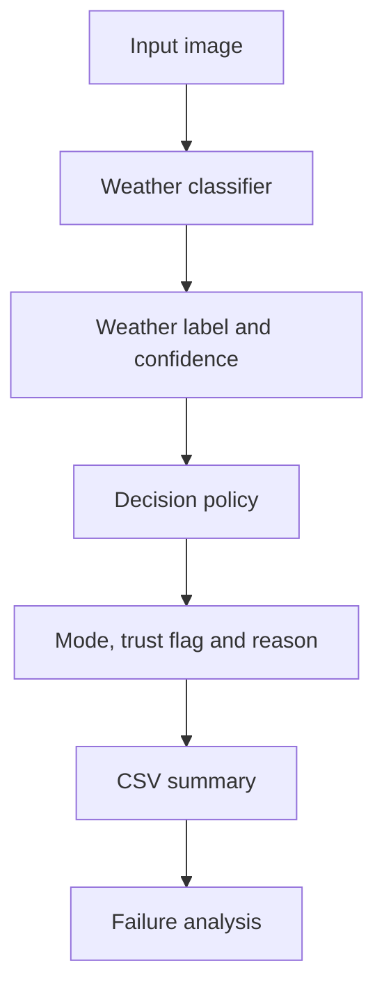

# Weather-Aware Lane Perception and Scene Analysis

A computer-vision project exploring how weather conditions affect road-scene perception and how model confidence can be used to flag uncertain predictions.

**Current runnable demo:** weather classification with a deterministic, rule-based assessment policy. The current demo pipeline is CPU-oriented and intentionally keeps lane detection disabled; lane outputs are placeholders. The repository also contains separate lane-perception and object-detection components described below, but they should not be interpreted as active inputs to the current demo pipeline.

> **Scope and safety:** This is an academic prototype for perception analysis. Its output labels are not vehicle-control commands and the project is not validated for real-world driving.

## Project goals

- Classify road-scene weather as clear, rainy, or snowy.
- Preserve the model's predicted label and confidence.
- Apply transparent rules to flag low-confidence weather predictions and adverse conditions.
- Save structured results that can be inspected and analyzed.
- Explore how additional lane and object perception signals could contribute to a more complete scene assessment.

## Current demo pipeline



The current implementation in `code/pipeline/main.py` calls the weather classifier and `decide_action_mode`. It sets lane detection to disabled, uses `unknown` lane visibility, and the policy normalizes that value to `medium`. Object detection is not called by this current pipeline entry point.

## Decision policy

The current policy in `code/pipeline/decision_policy.py` is deterministic:

| Condition | Returned mode | Trusted | Reason |
|---|---|---:|---|
| Weather confidence below 0.4 | caution | No | low_weather_confidence |
| Lane visibility is low | slow | No | poor_lane_visibility |
| Weather is snowy | slow | Yes | snow_conditions |
| Weather is rainy | normal | Yes | rain_conditions |
| Other / clear conditions | normal | Yes | clear_conditions |

When lane visibility is `None` or `unknown`, the policy treats it as `medium`. Since the current demo supplies `unknown`, the lane-visibility-low branch is not exercised by the current demo.

These are prototype rules, not calibrated safety thresholds. The returned `mode` is an assessment label; it is not connected to steering, braking, acceleration, or vehicle actuators.

## Components described in the repository

The repository documentation and source tree describe these areas:

| Component | Purpose |
|---|---|
| Weather classification | Predict a weather label and confidence |
| Lane-perception code | Explore lane structure and visibility |
| Object-detection code | Detect objects in road scenes |
| Decision policy | Apply transparent rules to weather confidence and lane visibility |
| Failure analysis | Summarize weather classification and trust-related cases |

The presence of a component in the repository does not mean it is currently connected to the demo pipeline. Check the entry point before assuming an end-to-end integration.

## Unit tests

The deterministic decision policy has a standard-library test suite covering its current branches and threshold boundary. From the repository root, run:

\`\`\`bash
python -m unittest discover -s tests -v
\`\`\`

These tests verify the implemented rules; they do not validate model accuracy or real-world driving safety.

## Failure analysis

The analysis script reads `analysis/decision_debug/summary.csv` and checks for the columns `gt_weather`, `pred_weather`, `confidence`, `trusted`, and `correct`.

Run it after generating a summary:

```bash
python -m analysis.failure_analysis
```

It writes the following reports to `analysis/failure_reports/`:

- `accuracy_by_weather.csv` — mean correctness grouped by ground-truth weather.
- `low_confidence.csv` — rows with confidence below 0.4.
- `misclassified.csv` — rows marked incorrect.
- `untrusted_decisions.csv` — rows where the trust flag is false.

The visualization script reads JPG images from subfolders under `results/showcase/` and writes `analysis/decision_debug/summary.csv`:

```bash
python -m analysis.decision_visualize
```

Expected showcase layout:

```text
results/
└── showcase/
    ├── clear/
    ├── rainy/
    └── snowy/
```

Each folder should contain JPG images. The folder name is used as the ground-truth weather label.

## Installation

Python 3.10 or newer is recommended. Create and activate a virtual environment:

```bash
python -m venv .venv
```

Windows PowerShell:

```powershell
.venv\Scripts\Activate.ps1
```

Linux / macOS:

```bash
source .venv/bin/activate
```

Install the dependencies declared by the repository:

```bash
python -m pip install --upgrade pip
pip install -r requirements.txt
```

The dependency list includes PyTorch, torchvision, OpenCV, NumPy, pandas, Matplotlib, Ultralytics, scikit-learn, tqdm, and addict. Installation may take time depending on the operating system and available hardware.

## Repository areas

```text
analysis/
  decision_engine.py
  decision_logic.py
  decision_visualize.py
  failure_analysis.py
code/
  classifier/
  detector/
  pipeline/
  unet/
  yolo/
  utils/
models/
datasets/
results/
tools/
requirements.txt
```

See the source files for the current implementation and execution path. Model weights and datasets may be excluded from Git because of their size.

## Known limitations

- The current demo pipeline disables lane detection and uses placeholder lane values.
- Object detection is not invoked by the current demo pipeline entry point.
- The current decision policy uses fixed, hand-written thresholds and rules.
- The current weather categories are limited to clear, rainy, and snowy.
- The failure-analysis script depends on a correctly generated summary CSV and ground-truth labels derived from folder names.
- The project has not been validated as a production or safety-critical driving system.
- No real-world driving safety claim is made.

## Next engineering priorities

1. Add automated unit tests for every decision-policy branch and threshold boundary.
2. Validate input labels, confidence values, and missing fields.
3. Connect lane perception only after its output contract and tests are defined.
4. Integrate object detections only with a documented, tested fusion rule.
5. Benchmark weather classification on a clearly described, held-out dataset.
6. Report measured results and limitations rather than estimated performance.

## Author

**Utkarsh Chougule**

